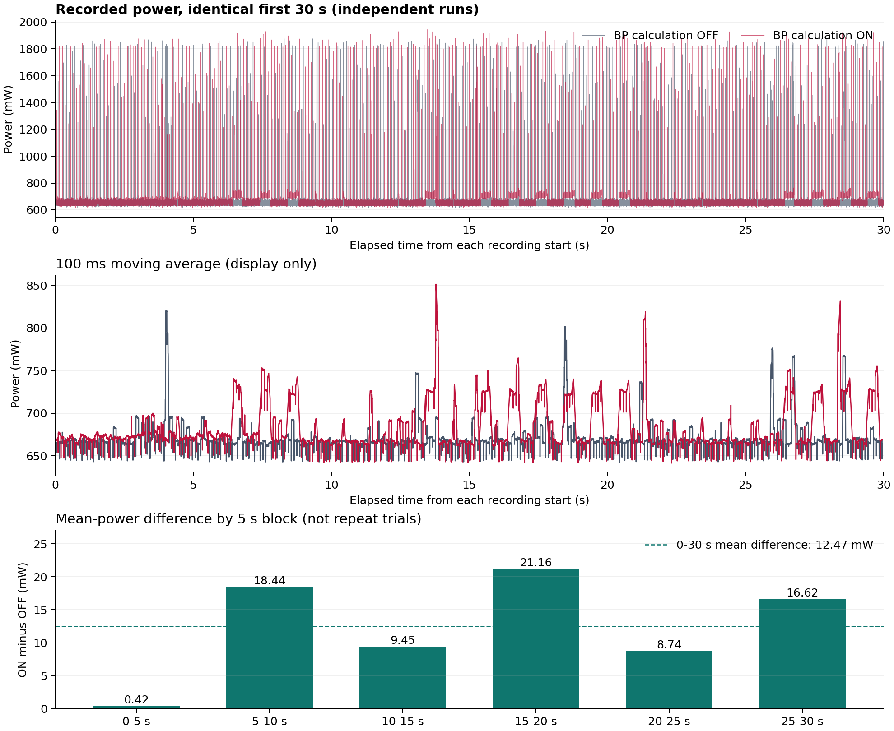

# 血压计算功耗实测分析

在两次测试仅切换血压计算开关、其余设置相同的条件下（用户确认），统一比较记录的前 30 秒：开启计算后测量点平均功率增加 **12.47 mW**，相对未开启状态增加 **1.86%**。30 秒新增能耗为 **0.3741 J**。

这里测得的是血压计算流程引入的系统功率增量，包含特征提取、模型推理、血压处理及开关该流程引起的附带开销；不能进一步分离为纯模型或单独 MCU 内核的电功率。

## 同时长比较：0–30 秒

| 指标 | 未运行血压计算 | 运行血压计算 | 开启后变化 |
|---|---:|---:|---:|
| 时间加权平均功率（mW） | 671.267 | 683.738 | +12.471 |
| 相对基线功率增幅 | — | — | +1.858% |
| 平均电流（mA） | 136.835 | 139.417 | +2.583 |
| 平均电压（V） | 4.9084 | 4.9071 | -0.0013 |
| 30 秒能耗（J） | 20.138017 | 20.512140 | +0.374124 |
| 30 秒能耗（mWh） | 5.593894 | 5.697817 | +0.103923 |
| 采样值最大功率（mW） | 1876.630 | 1944.740 | 不用于推算模型峰值 |
| 采样功率中位数（mW） | 639.416 | 648.915 | — |
| 采样功率 P95（mW） | 683.829 | 729.225 | — |
| 样本点数（含两端） | 15,001 | 15,001 | — |

主结果使用 0–30 秒原始功率，不删除尖峰、不平滑后求均值，也不将平均电压乘平均电流代替平均功率。两组为独立录制，时间轴从各自记录起点对齐，不代表同步采样。

## 时段敏感性

| 分析区间 | 未运行平均功率（mW） | 运行平均功率（mW） | 差值（mW） | 增幅 |
|---|---:|---:|---:|---:|
| 0–5 s | 672.945 | 673.367 | +0.422 | +0.063% |
| 5–10 s | 667.979 | 686.417 | +18.437 | +2.760% |
| 10–15 s | 669.482 | 678.935 | +9.452 | +1.412% |
| 15–20 s | 672.984 | 694.139 | +21.156 | +3.144% |
| 20–25 s | 669.262 | 677.997 | +8.735 | +1.305% |
| 25–30 s | 674.951 | 691.573 | +16.622 | +2.463% |
| 合计 5–30 s | 670.932 | 685.812 | +14.880 | +2.218% |

前 5 秒平均功率差只有约 0.42 mW。当前算法需要约 5 秒采样窗口才能开始计算，这与前段差异较小相容，但 CSV 没有同步模型日志，不能确认录制起点对应设备启动或计算启动。因此以全 30 秒为主结果，5–30 秒仅作补充，不直接命名为已验证的稳态功耗。5 秒分段也不是独立重复实验。

## 原始文件与核对

| 文件 | 原始行数 | 实际记录时长（s） | 时间间隔 |
|---|---:|---:|---:|
| 未加载血压计算数据.csv | 15,420 | 30.838 | 全部 2 ms |
| 运行血压数据.csv | 16,492 | 32.982 | 全部 2 ms |

两份文件均以 GB18030 编码导出，所需字段无缺失/非数值、时间严格递增、没有重复时间或时间缺口。CSV 时间间隔对应 500 个记录点/秒，仪器实际模拟带宽和更新速率未提供。

由于原始记录时长不相等，不能直接相减两份文件的累计总能量来归因于模型。统一 30 秒积分使用 15,001 个端点样本与 15,000 个时间间隔。

| 0–30 秒能耗核对 | 功率曲线积分（J） | 仪器累计能量差（J） | 相对差异 |
|---|---:|---:|---:|
| 未运行 | 20.138017 | 20.138886 | -0.004316% |
| 运行 | 20.512140 | 20.512140 | -0.000000% |

累计能量列在起点已非零，所以核对时使用末值减初值。能量列可能与功率列来自同一仪器积分，此核对验证计算一致性，不代表独立校准了仪器精度。记录功率与同点 U×I 的最大差约 0.0052 mW，与导出小数精度相容。

按全部原始时长计算，未运行和运行的平均功率分别为 672.423 mW、684.982 mW，均值差约 12.558 mW，与等长主结果接近。

## 计算方法与适用范围

平均功率：P̄ = Σ[(Pᵢ + Pᵢ₊₁)/2 × (tᵢ₊₁ − tᵢ)] / T。

新增平均功率：ΔP̄ = P̄开启 − P̄关闭；新增能耗：ΔE = ΔP̄ × 30 s；1 Wh = 3600 J。

- 用户已确认两次测试使用相同供电、人体信号连接和采集/通信设置，仅切换血压计算。
- 功率测量点的具体位置、仪器型号及精度未提供，报告保留测量点口径，不折算为芯片 3.3 V 供电轨功率。
- 每个状态只有一段记录。约 1.86% 是本次差异，尚无重复试验和仪器精度信息来量化测量不确定度。
- 没有这两段功率记录对应的模型执行/成功输出计数，不能准确给出每次成功血压计算的能耗；不能套用上午另一轮日志中的成功率或耗时。

## 可引用表述

> 在相同采集与通信配置下，分别关闭和开启血压计算流程进行功率测试。对两组前 30 秒记录积分得到平均功率分别为 671.27 mW 和 683.74 mW。开启血压计算引入的平均功率增量为 12.47 mW（1.86%），对应 30 秒额外能耗 0.3741 J。

## 图与可复核数据

`summary.json` 保存未舍入统计值、分段结果、源文件路径和 SHA-256。原始 CSV 保持不变；分析脚本为项目 tmp/analyze_bp_power.py。

## 功率尖峰补充分析

[查看尖峰周期、可能来源与验证方法](spike_analysis.md)。
