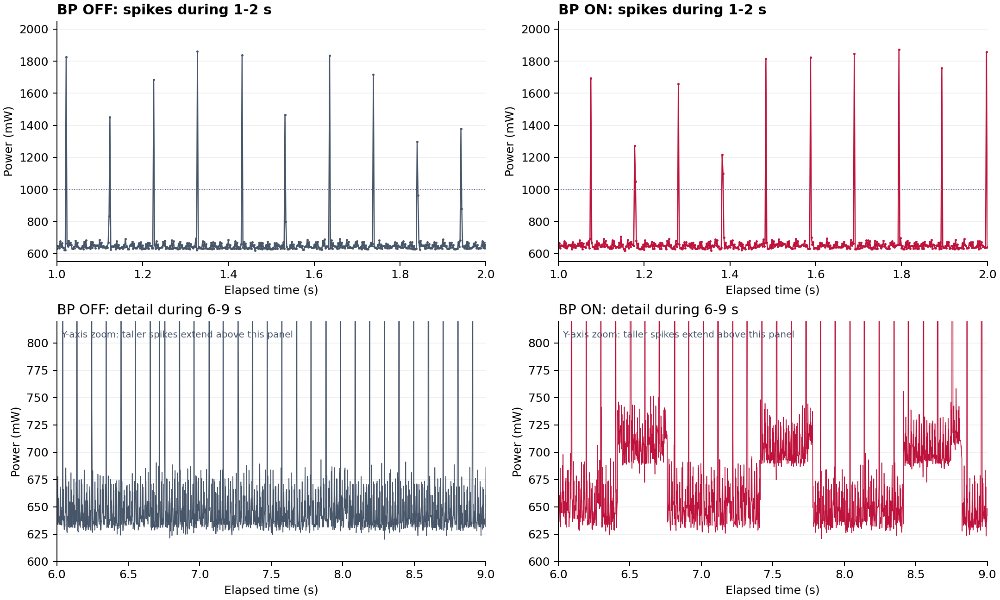

# 功率尖峰来源分析

**主要推断：两组共有、间隔约 102.4 ms 的窄尖峰最可能来自 Wi-Fi SoftAP 的周期信标发射。** 开启血压计算后出现的较宽、较低的平台状抬升则更可能与计算任务有关。当前证据是功率波形与代码/协议周期的吻合，尚未做同步测量或改变信标周期的因果验证。

## 从原始数据观察到的事实

统一使用两组各自前 30 秒，以大于 1 W 的连续记录点作为一次“窄高尖峰”事件。1 W 是本次分析阈值，不是器件故障阈值。

| 指标 | 关闭血压计算 | 开启血压计算 |
|---|---:|---:|
| 采样最大功率（W） | 1.87663 | 1.94474 |
| 采样最大输入电流（mA） | 390.1 | 401.1 |
| 大于 1 W 的连续事件数 | 313 | 314 |
| 大于 1 W 的样本点占比（%） | 2.620 | 2.646 |
| 相邻尖峰时间差中位数（ms） | 102.0 | 102.0 |
| 5–15 Hz 候选频段内尖峰序列谱峰（Hz） | 9.766 | 9.766 |
| 对应周期（ms） | 102.4 | 102.4 |
| 尖峰样本区间中位跨度（ms） | 2.0 | 2.0 |
| 大于 1 W 时输入电压中位数（V） | 4.8435 | 4.8273 |
| 小于 0.8 W 时输入电压中位数（V） | 4.9123 | 4.9111 |

两组共有约 10 次/秒的高尖峰，事件数分别 313 和 314，说明这些尖峰不依赖血压计算开启。检测到的相邻间隔主要落在 100、102、104 ms，受 2 ms 采样量化、发射时刻抖动及附加事件影响；不能直接用 313/30 当作精确的信标频率。

将阈值提高至 1.5 W，规则尖峰仍存在。两组在 102.4 ms 候选周期下的事件相位集中度分别为 0.921、0.930，在 100 ms 下分别仅为 0.008、0.008。该描述量取值 0–1，越接近 1 表示事件越集中于相同周期相位；这里用于支持候选周期，不作为概率或统计置信度。

多数高尖峰仅占一个 2 ms 记录点。这个 2 ms 不能解释为已测得真实脉宽，仪器带宽和真实瞬时峰值仍未知。

## 为什么首先怀疑 Wi-Fi 信标

1. 当前 main 在血压计算开关之外调用 `wifi_init_softap()`，因此关闭模型仍会开启热点。
2. `components/software/WIFI/wifi.c` 的热点配置没有显式设置 `beacon_interval`，使用默认值。
3. 本机 ESP-IDF 6.1 头文件与官方 API 均规定：默认信标间隔为 100 TU，1 TU = 1024 μs，因此周期是 102.4 ms，频率约 9.765625 Hz。这与功率数据候选谱峰约 9.766 Hz 相符。

[ESP-IDF 6.1 官方 wifi_ap_config_t 定义](https://docs.espressif.com/projects/esp-idf/en/v6.1/esp32s3/api-reference/network/esp_wifi.html#_CPPv416wifi_ap_config_t)

热点即使没有应用层数据发送，也要周期广播信标。因此“未运行血压模型”不等于“没有无线发射”。另外，协议任务会把三路采样编码为独立小帧，并在 TCP 客户端连接时提交 Wi-Fi 发送；上位机连接、数据发送及重传可以带来附加的不规则尖峰，但 CSV 无法逐项确认。

## 较宽的功率抬升

放大 6–9 秒区间，开启计算的数据出现约每秒一次、持续约数百毫秒的较低平台，关闭计算时没有同样清楚的平台。这与算法每 1 秒产生一个窗口，以及此前另一次测得约 396 ms 的窗口处理耗时相容。推断它主要对应特征提取、Flash 模型遍历和血压处理的 CPU/存储访问活动。由于不是同步日志，尚不能把每个平台与某次成功计算一一匹配。

`sdkconfig` 未开启 CONFIG_PM_ENABLE，因而“动态调频从低频切到高频”不是当前配置下的优先解释；CPU 频率固定也不代表执行负载不会改变电流。

## 电压变化与仪器边界

高功率点同时有更高电流，输入电压中位数也比低功率点低约 69–84 mV，支持它们与瞬时负载变化相伴。这不是仅仅将功率列画错了，也不能据此直接断定电源不稳定。供电线阻、输入电容与电源转换电路都会影响仪器端看到的波形；未同步观察板上电源轨和复位信号。

## 如何验证推断

| 后续对照 | 若信标推断成立，预期看到什么 |
|---|---|
| 临时将 SoftAP 的 beacon_interval 设为 200 TU，其他条件一致 | 规则高尖峰主周期移到约 204.8 ms，频率约 4.88 Hz |
| 临时关闭 Wi-Fi、保留 USB 数据输出，其他条件尽量一致 | 102.4 ms 的规则高尖峰明显减少或消失 |
| 计算入口/出口翻转 GPIO，并与功率数据同步采集 | 低而宽的平台与计算区间重合 |

以上为建议的验证方案，本次没有修改固件配置或执行这些对照。

## 对先前平均功耗结果的影响

高尖峰是实测输入功率的一部分，原先积分已经保留了它们。不能为了得到更小的模型功耗而删掉尖峰。关闭和开启状态都存在周期发射负载，等长均值差可估计计算流程增量，但只有一次独立记录/状态，剩余发射波动和仪器误差仍会影响约 2% 的小差值。

`spike_summary.json` 保存统计与原始文件 SHA-256，`spike_events_*.json` 保留阈值事件。原始 CSV 未修改。
