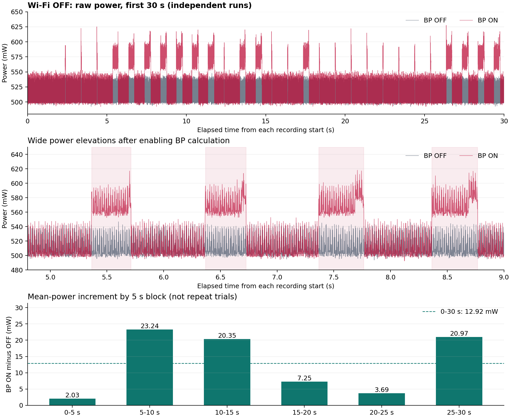

# 无 Wi-Fi 血压计算功耗分析

## 有效宽峰的计算期间平均功率（用户确认）

用户已确认宽峰对应血压模型计算。按完整文件的 19 个有效宽峰重新统计：不计算平均 **510.66 mW**，宽峰内时间加权平均 **570.70 mW**，计算期间增加 **60.04 mW（11.76%）**。

[查看简要结果及统计口径](active_power_summary.md)。以下保留此前前 30 秒的全程统计，便于区分活动期间功率与整段平均功率。

统一比较两份记录的前 30 秒，未运行血压计算时平均功率为 **510.72 mW**，运行时为 **523.64 mW**。开启计算的平均功率增量为 **12.92 mW（2.53%）**，30 秒额外能耗为 **0.3877 J**。

沿用之前的 5–30 秒补充口径，增量为 **15.10 mW（2.96%）**。这与之前带 Wi-Fi 时同区间的 14.88 mW 接近。

本次宽峰呈现持续的功率抬升，符合周期计算负载的表现；原先约 1.9 W 的窄高尖峰在新记录中没有出现。

## 0–30 秒同区间结果

| 指标 | 未运行血压计算 | 运行血压计算 | 开启后的变化 |
|---|---:|---:|---:|
| 平均功率（mW） | 510.716 | 523.639 | +12.923 |
| 相对基线增幅 | — | — | +2.530% |
| 平均输入电流（mA） | 103.587 | 106.272 | +2.685 |
| 平均输入电压（V） | 4.9303 | 4.9274 | -0.0028 |
| 30 秒能耗（J） | 15.321466 | 15.709169 | +0.387704 |
| 30 秒能耗（mWh） | 4.255963 | 4.363658 | +0.107695 |
| 记录最大功率（mW） | 548.040 | 627.593 | 不等同于真实瞬时峰值 |
| 功率中位数（mW） | 502.617 | 507.699 | — |
| 功率 P95（mW） | 539.813 | 580.985 | — |

平均功率使用原始功率对实际时间的梯形积分除以时长；保留全部尖峰，不用平均电压乘平均电流代替。两次记录分别从各自起点计时，不能作同步逐点相减。

## 宽峰分析

用户截图显示低功率区与宽峰交替出现。下图使用本次 CSV 的 4.8–9 秒区间进行核对。为客观描述宽峰，采用 20 ms 移动平均后高于 550 mW 的区间，合并不超过 50 ms 的间隙，仅保留跨度至少 100 ms 的事件。550 mW 高于本次无计算基线的全部记录值；该阈值只用于描述宽峰，未用于删改能量积分。

| 宽峰特征，0–30 秒 | 未运行血压计算 | 运行血压计算 |
|---|---:|---:|
| 符合上述定义的宽峰数 | 0 | 14 |
| 宽峰跨度中位数（ms） | — | 400.0 |
| 宽峰跨度范围（ms） | — | 346.0–404.0 |
| 相邻宽峰起点间隔中位数（ms） | — | 1002.0 |
| 各宽峰平均功率的中位数（mW） | — | 571.1 |

截图中 5–9 秒附近的宽峰对应记录：

| 宽峰起点（s） | 宽峰终点（s） | 跨度（ms） | 区间平均功率（mW） |
|---:|---:|---:|---:|
| 5.366 | 5.712 | 346.0 | 568.4 |
| 6.368 | 6.726 | 358.0 | 569.6 |
| 7.368 | 7.764 | 396.0 | 571.3 |
| 8.364 | 8.766 | 402.0 | 571.4 |

宽峰的周期和数百毫秒跨度与项目每 1 秒推进一个计算窗口、之前另一轮日志约 396 ms 的窗口处理耗时相容，最可能对应特征提取、模型读取/推理和血压后处理期间的 CPU 与存储访问负载。未同步采集 GPIO 或模型日志，因此这里是负载归因推测，不是实测任务起止或模型推理时间。阈值、平滑和测量响应均会影响上述跨度。

**宽峰比全程平均增量明显是正常的：计算只占每个周期的一部分时间。全程约 13–15 mW 的增量不能解释为计算期间只增加 13–15 mW。** 不能把两个独立记录的最大值之差直接作为模型峰值功率，也不能将某一个宽峰的全部电量当作模型电量，必须考虑同期基线。

各宽峰区间平均功率中位数约 571.1 mW，与无计算全程平均基线 510.7 mW 相比约高 60.4 mW。这是两个独立记录的描述性对比，仅帮助理解活动期间的功率尺度，不是同步测得的纯模型功率。

全 30 秒按上述定义只检测到 14 个明显宽峰，15–25 秒尤为稀少，因此不能将此段录制视为每秒都执行一次相同完整推理的连续满负载测试。`wk_realtime_pipeline.c` 在特征/信号质量检查失败时会提前返回 `WK_RT_SIGNAL_REJECTED`，其他错误也可提前结束流程；这是窄峰和宽峰交替的一种合理解释，尚无本轮同步日志来确认各次状态。14 个宽峰也不等同于 14 次成功预测。若要报告持续执行完整流程的平均功耗，应结合稳定输入及对应日志重新统计。

## 时段敏感性

| 区间 | 未运行平均功率（mW） | 运行平均功率（mW） | 平均增量（mW） | 增幅 |
|---|---:|---:|---:|---:|
| 0–5 s | 511.172 | 513.203 | +2.031 | +0.397% |
| 5–10 s | 511.151 | 534.395 | +23.244 | +4.547% |
| 10–15 s | 510.775 | 531.127 | +20.352 | +3.984% |
| 15–20 s | 510.648 | 517.899 | +7.251 | +1.420% |
| 20–25 s | 510.363 | 514.053 | +3.690 | +0.723% |
| 25–30 s | 510.184 | 531.157 | +20.973 | +4.111% |
| 合计 0–30 s | 510.716 | 523.639 | +12.923 | +2.530% |
| 补充 5–30 s | 510.624 | 525.726 | +15.102 | +2.958% |
| 全部共同区间 0–33.158 s | 510.659 | 524.701 | +14.042 | +2.750% |
| 补充 5–33.158 s | 510.567 | 526.743 | +16.175 | +3.168% |

0–30 秒为与上次一致的主结果。5–30 秒沿用此前的补充口径：算法需要约 5 秒采样窗口，但功率录制起点没有与设备启动/模型启动同步，不能将其直接命名为已验证的稳态区间。完整共同区间用于检查截取前 30 秒是否改变结论。每个 5 秒分段不是一次独立重复实验。

## 与之前带 Wi-Fi 的结果比较

| 条件 | 带 Wi-Fi | 无 Wi-Fi |
|---|---:|---:|
| 未运行计算平均功率，0–30 s（mW） | 671.267 | 510.716 |
| 运行计算平均功率，0–30 s（mW） | 683.738 | 523.639 |
| 血压计算平均增量，0–30 s（mW） | 12.471 | 12.923 |
| 血压计算平均增量，5–30 s（mW） | 14.880 | 15.102 |
| 未运行计算的最大记录功率（W） | 1.876630 | 0.548040 |
| 运行计算的最大记录功率（W） | 1.944740 | 0.627593 |
| 超过 1 W 的连续尖峰段数，关闭/开启计算 | 313 / 314 | 0 / 0 |

两次会话中系统平均功率下降约 160.55 mW（关闭计算）与 160.10 mW（开启计算）。如果跨会话的供电、采集、信号、串口输出及仪器设置一致，这反映禁用 Wi-Fi 及相关任务带来的系统功率下降；不解释为单独射频芯片的精确功耗。

原先约 102.4 ms 周期的 >1 W 窄高尖峰在禁用 Wi-Fi 后未再出现，进一步支持其主要与 Wi-Fi 活动有关的判断；目前仍未单独改变信标周期，所以尚不能把原来每一个尖峰都归因于信标。血压计算增量在两次会话中接近，说明此前平均增量较小并非简单地被 Wi-Fi 尖峰遮蔽。

[之前带 Wi-Fi 的报告](../bp_power_20261019/report.md)；[之前的尖峰分析](../bp_power_20261019/spike_analysis.md)。

## 原始数据与计算核对

| 文件 | 编码 | 行数 | 原始时长（s） | 记录间隔 |
|---|---|---:|---:|---|
| 未加载血压计算数据（无wifi）.csv | gb18030 | 16,580 | 33.158 | 全部 2 ms |
| 运行血压数据(无wifi).csv | gb18030 | 20,060 | 40.118 | 全部 2 ms |

所需字段均为有限数值，时间严格递增且无记录间隔缺口，累计能量未下降。原始时长不同，不能直接相减两份文件的累计总能量。主比较每组含 15,001 个端点记录与 15,000 个时间间隔。原始 CSV 未修改。

| 0–30 秒能量核对 | 原始功率积分（J） | 累计 Wh 末值减初值换算（J） | 相对差异 |
|---|---:|---:|---:|
| 未运行 | 15.321466 | 15.321451 | +0.000097% |
| 运行 | 15.709169 | 15.709169 | +0.000001% |

记录功率与同点电压×电流的最大偏差为 0.000560 mW。累计能量与功率可能来自同一仪器，此核对验证计算一致性，不代表独立验证仪器精度。

平均功率：P̄ = Σ[(Pᵢ+Pᵢ₊₁)/2 × (tᵢ₊₁−tᵢ)] / T。新增平均功率：ΔP̄ = P̄开启−P̄关闭。新增能耗：ΔE = E开启−E关闭。1 Wh = 3600 J。

## 适用范围

- 按用户提供的文件名标注关闭/开启血压计算且两组均无 Wi-Fi；功耗归因假设除计算开关外其余条件一致，CSV 本身不能独立验证连接状态或固件版本。
- 结果是测量点处血压计算流程的系统平均增量，包含特征提取、推理和后处理及其附带开销；不等同于纯模型、单核或 3.3 V 供电轨功率。
- 每种状态只有一段独立记录，且仪器精度和带宽未提供，暂不能量化重复性或置信区间。
- 没有同步计算执行次数或成功输出数，不能直接给出单次成功预测的实测能耗，也不能将之前另一轮的运行时间当成本轮测量结果。

## 图与复核数据

`summary.json` 保留完整精度、源文件 SHA-256、完整原始记录统计、同区间结果、分段数据与宽峰事件。分析脚本：`tmp/analyze_bp_power_no_wifi.py`。
